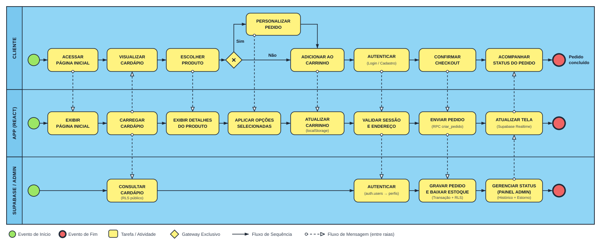
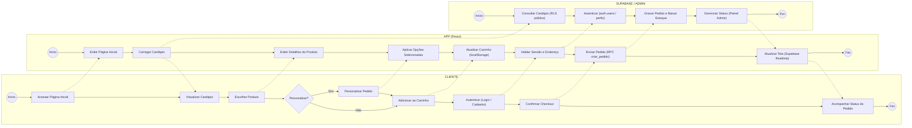
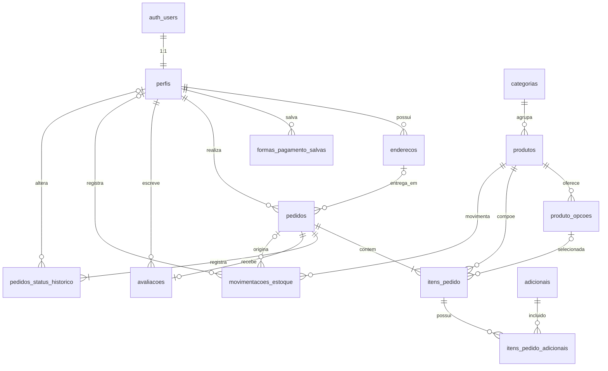

# 🍔 BURGUERTEC

Landing page e loja virtual de uma hamburgueria fictícia, desenvolvida como projeto avaliativo da disciplina de **Programação para Dispositivos Móveis II**.

## 📚 Informações acadêmicas

| | |
|---|---|
| **Disciplina** | Programação para Dispositivos Móveis II |
| **Professor** | Bruno Zolotareff dos Santos |
| **Metodologia** | Ágil (Scrum) |
| **Team Member** | Miguel Martins |
| **Team Member** | Luis Felipe Maia da Costa |
| **Equipe** | Hamburgueria |

## 📖 Sobre o projeto

O **BURGUERTEC** é uma aplicação de pedidos para uma hamburgueria, pensada como um projeto **multiplataforma**: a versão **Web** é construída em **React**, e uma versão **Mobile** está planejada em **React Native**, compartilhando a mesma identidade visual, cardápio e lógica de negócio entre as duas plataformas.

O desenvolvimento segue a metodologia ágil com **Scrum**: o board do Trello foi montado antes do início da implementação, e cada card corresponde a um commit no histórico deste repositório, refletindo a evolução real do projeto por funcionalidade.

## ✨ Funcionalidades

- **Landing page** com identidade visual própria, seções de apresentação, cardápio, história da marca e rodapé institucional
- **Cardápio interativo** com fotos, descrição e preço de cada lanche
- **Personalização de pedido**: ponto da carne, adicional de batata, remoção de ingredientes e controle de quantidade
- **Carrinho de compras** com suporte a múltiplos itens personalizados, cálculo automático de total e remoção individual
- **Autenticação**: telas de login e criação de conta
- **Responsividade**: layout adaptado para desktop e mobile

## 🛠️ Tecnologias

**Web (este repositório)**
- [React](https://react.dev/) + [Vite](https://vitejs.dev/)
- CSS puro
- [Lucide React](https://lucide.dev/) para ícones
- [Express](https://expressjs.com/) para servir o build em produção

**Mobile (planejado)**
- [React Native](https://reactnative.dev/)

## 🚀 Como rodar o projeto

Pré-requisito: [Node.js](https://nodejs.org/) 18 ou superior.

```bash
# instalar dependências
npm install

# rodar em modo desenvolvimento
npm run dev

# gerar build de produção e subir o servidor
npm run build
npm start
```

No Windows, o `deploy.bat` executa os três passos acima automaticamente.

## 📁 Estrutura do projeto

```
burguertec-app/
├── index.html
├── package.json
├── vite.config.js
├── server.js              # servidor Express (porta única)
├── deploy.bat              # build + start automatizados (Windows)
└── src/
    ├── main.jsx
    ├── App.jsx             # componente principal
    ├── App.css             # estilos
    ├── pages/
    │   ├── Login.jsx
    │   └── Cadastro.jsx
    └── components/
        └── ProductModal.jsx  # modal de personalização do pedido
```

## 📌 Histórico de desenvolvimento

O histórico de commits deste repositório reflete a ordem dos cards planejados no Kanban do projeto, um commit por funcionalidade entregue — da navegação principal até o gerenciamento completo do carrinho.

## 🔄 Modelagem de Processos (BPMN)

O fluxo ponta a ponta da aplicação — da navegação no cardápio e personalização de itens ao checkout transacional, acompanhamento em tempo real e gerenciamento administrativo — é representado pelo **Diagrama de Colaboração BPMN 2.0** ([`docs/bpmn-fluxo-pedido.svg`](docs/bpmn-fluxo-pedido.svg)):



### Participantes e elementos do diagrama

- **Raias (*Pools / Lanes*):**
  - **`CLIENTE`:** ações do usuário no navegador (acesso, seleção, personalização, autenticação, checkout e acompanhamento).
  - **`APP (REACT)`:** carregamento do cardápio, gerenciamento do carrinho em `localStorage`, validação da sessão/endereço, chamada à RPC `criar_pedido` e assinatura de atualizações via Supabase Realtime.
  - **`SUPABASE / ADMIN`:** consultas públicas filtradas por RLS, criação automática de perfil (`auth.users` → `perfis`), gravação transacional com baixa de estoque e evolução de status no painel administrativo (`pedidos_status_historico` e estorno automático em cancelamentos).
- **Notação BPMN 2.0:** eventos de início (círculo verde), eventos de fim (círculo vermelho com borda espessa), tarefas (retângulos amarelos), gateway exclusivo (`×` para personalização do item), fluxos de sequência (setas contínuas) e fluxos de mensagem (`o---▷` tracejados entre raias).

<details>
<summary>Versão alternativa em Mermaid (fluxograma por raias)</summary>



</details>

## 🗄️ Modelagem de Dados

A persistência da aplicação utiliza **PostgreSQL (Supabase)**, com esquema definido nas migrações em [`supabase/migrations/`](supabase/migrations/) e documentado tecnicamente em [`docs/ARQUITETURA_DADOS.md`](docs/ARQUITETURA_DADOS.md). Ao todo, o modelo consolidado conta com **13 tabelas no schema `public`** (integradas `1:1` à tabela externa `auth.users` do Supabase Auth) e **4 tipos enumerados (`ENUM`)**.

> **Nota de arquitetura:** O carrinho de compras (`burguertec:carrinho`) permanece transitório no `localStorage` do navegador e só é persistido no banco no checkout via função transacional (RPC) `criar_pedido`. A tabela `avaliacoes` já está modelada e protegida por RLS no banco, aguardando implementação de interface no front-end.

### Modelo Conceitual (MER)

#### Entidades por domínio

- **Identidade e preferências:** `auth.users` *(externa / Supabase Auth)*, `perfis`, `enderecos`, `formas_pagamento_salvas`
- **Catálogo:** `categorias`, `produtos`, `produto_opcoes`, `adicionais`
- **Vendas e pedidos:** `pedidos`, `itens_pedido`, `itens_pedido_adicionais`
- **Auditoria e feedback:** `pedidos_status_historico`, `movimentacoes_estoque`, `avaliacoes`

#### Diagrama Entidade-Relacionamento (ER)



#### Relacionamentos e cardinalidades `(min, máx)`

| Relacionamento | Entidade origem | Card. origem → destino | Entidade destino | Card. destino → origem | Ação referencial (`ON DELETE`) |
|---|---|---|---|---|---|
| Cadastro de conta | `auth.users` | `(1,1)` | `perfis` | `(1,1)` | `CASCADE` (via trigger `on_auth_user_created`) |
| Endereços do cliente | `perfis` | `(0,N)` | `enderecos` | `(1,1)` | `CASCADE` |
| Preferências de pagamento | `perfis` | `(0,N)` | `formas_pagamento_salvas` | `(1,1)` | `CASCADE` |
| Realização de pedidos | `perfis` | `(0,N)` | `pedidos` | `(1,1)` | `CASCADE` |
| Local de entrega | `enderecos` | `(0,N)` | `pedidos` | `(0,1)` | `SET NULL` (`NULL` em retirada no balcão) |
| Classificação no cardápio | `categorias` | `(0,N)` | `produtos` | `(1,1)` | `RESTRICT` |
| Opções / sabores do produto | `produtos` | `(0,N)` | `produto_opcoes` | `(1,1)` | `CASCADE` |
| Composição do pedido | `pedidos` | `(1,N)` | `itens_pedido` | `(1,1)` | `CASCADE` |
| Produto pedido | `produtos` | `(0,N)` | `itens_pedido` | `(1,1)` | `RESTRICT` (preserva histórico) |
| Opção escolhida no item | `produto_opcoes` | `(0,N)` | `itens_pedido` | `(0,1)` | `SET NULL` (mantém snapshot `opcao_nome`) |
| Adicionais do item (`N:M`) | `itens_pedido` | `(0,N)` | `itens_pedido_adicionais` | `(1,1)` | `CASCADE` |
| Catálogo de adicionais | `adicionais` | `(0,N)` | `itens_pedido_adicionais` | `(1,1)` | `RESTRICT` |
| Linha do tempo do pedido | `pedidos` | `(1,N)` | `pedidos_status_historico` | `(1,1)` | `CASCADE` |
| Autor da alteração de status | `perfis` | `(0,N)` | `pedidos_status_historico` | `(0,1)` | `SET NULL` |
| Movimentação de estoque | `produtos` | `(0,N)` | `movimentacoes_estoque` | `(1,1)` | `CASCADE` |
| Vínculo de venda / estorno | `pedidos` | `(0,N)` | `movimentacoes_estoque` | `(0,1)` | `SET NULL` |
| Operador da movimentação | `perfis` | `(0,N)` | `movimentacoes_estoque` | `(0,1)` | `SET NULL` (`NULL` em venda automática) |
| Avaliação do pedido | `pedidos` | `(0,1)` | `avaliacoes` | `(1,1)` | `CASCADE` (PK compartilhada `pedido_id`) |
| Autor da avaliação | `perfis` | `(0,N)` | `avaliacoes` | `(1,1)` | `CASCADE` |

### Modelo Lógico Relacional

#### Tipos enumerados (`ENUM`)

- **`status_pedido`**: `'recebido'`, `'em_preparo'`, `'saiu_para_entrega'`, `'entregue'`, `'cancelado'`
- **`forma_pagamento`**: `'pix'`, `'cartao_credito'`, `'cartao_debito'`, `'dinheiro'`
- **`ponto_carne`**: `'mal'`, `'ponto'`, `'bem'`
- **`motivo_estoque`**: `'entrada'`, `'ajuste'`, `'perda'`, `'venda'`, `'cancelamento'`

#### Esquema relacional (notação textual)

Legenda: <u>**chave**</u> = Chave Primária (`PK`) · `#atributo` = Chave Estrangeira (`FK`) · `[UQ]` = Valor Único (`UNIQUE`)

- **categorias** (<u>**id**</u>, nome `[UQ]`, ordem)
- **produtos** (<u>**id**</u>, `#categoria_id`, nome, descricao, preco, imagem_url, imagem_posicao, permite_ponto, rotulo_opcao, ativo, ordem, controla_estoque, estoque, estoque_minimo, created_at)
- **produto_opcoes** (<u>**id**</u>, `#produto_id`, nome, preco_adicional, ativo, ordem)
- **adicionais** (<u>**id**</u>, nome, preco, ativo)
- **perfis** (<u>**#id**</u>, nome, telefone, cpf `[UQ]`, is_admin, created_at)
- **enderecos** (<u>**id**</u>, `#usuario_id`, apelido, cep, logradouro, numero, complemento, bairro, cidade, uf, principal, created_at)
- **formas_pagamento_salvas** (<u>**id**</u>, `#usuario_id`, tipo, apelido, bandeira, final_cartao, titular, validade, principal, created_at)
- **pedidos** (<u>**id**</u>, `#usuario_id`, `#endereco_id`, status, forma_pagamento, subtotal, taxa_entrega, total, observacao, endereco_entrega, created_at, updated_at)
- **itens_pedido** (<u>**id**</u>, `#pedido_id`, `#produto_id`, `#opcao_id`, nome_produto, opcao_nome, preco_unitario, quantidade, ponto_carne, observacao, subtotal)
- **itens_pedido_adicionais** (<u>**#item_id**</u>, <u>**#adicional_id**</u>, preco)
- **pedidos_status_historico** (<u>**id**</u>, `#pedido_id`, status, `#alterado_por`, created_at)
- **movimentacoes_estoque** (<u>**id**</u>, `#produto_id`, `#pedido_id`, `#usuario_id`, quantidade, motivo, observacao, created_at)
- **avaliacoes** (<u>**#pedido_id**</u>, `#usuario_id`, nota, comentario, created_at)

#### Detalhamento de chaves, tipos e restrições

| Tabela | Chave Primária | Chaves Estrangeiras | Colunas, tipos e principais restrições |
|---|---|---|---|
| `categorias` | `id` (`smallint` identity) | — | `nome` (`text`, not null, `UNIQUE`), `ordem` (`int`, default `0`) |
| `produtos` | `id` (`text` slug) | `categoria_id` → `categorias(id)` | `nome` (`text`), `descricao` (`text`), `preco` (`numeric(10,2)`, `>= 0`), `imagem_url` (`text`), `imagem_posicao` (`text`, default `'bottom'`), `permite_ponto` (`boolean`), `rotulo_opcao` (`text`), `ativo` (`boolean`), `ordem` (`int`), `controla_estoque` (`boolean`), `estoque` (`int`, `>= 0`), `estoque_minimo` (`int`, `>= 0`), `created_at` (`timestamptz`) |
| `produto_opcoes` | `id` (`text` slug) | `produto_id` → `produtos(id)` | `nome` (`text`), `preco_adicional` (`numeric(10,2)`, `>= 0`), `ativo` (`boolean`), `ordem` (`int`) |
| `adicionais` | `id` (`text` slug) | — | `nome` (`text`), `preco` (`numeric(10,2)`, `>= 0`), `ativo` (`boolean`) |
| `perfis` | `id` (`uuid`) | `id` → `auth.users(id)` | `nome` (`text`), `telefone` (`text`), `cpf` (`text`, `UNIQUE`), `is_admin` (`boolean`, default `false`), `created_at` (`timestamptz`) |
| `enderecos` | `id` (`uuid`) | `usuario_id` → `perfis(id)` | `apelido` (`text`), `cep` (`text`), `logradouro` (`text`), `numero` (`text`), `complemento` (`text`), `bairro` (`text`), `cidade` (`text`), `uf` (`char(2)`), `principal` (`boolean`), `created_at` (`timestamptz`) |
| `formas_pagamento_salvas` | `id` (`uuid`) | `usuario_id` → `perfis(id)` | `tipo` (`forma_pagamento`), `apelido` (`text`), `bandeira` (`text`, enum check), `final_cartao` (`char(4)`, `^[0-9]{4}$`), `titular` (`text`), `validade` (`text`, `MM/AA`), `principal` (`boolean`, índice único parcial por `usuario_id`), `created_at` (`timestamptz`) |
| `pedidos` | `id` (`bigint` identity) | `usuario_id` → `perfis(id)`, `endereco_id` → `enderecos(id)` | `status` (`status_pedido`), `forma_pagamento` (`forma_pagamento`), `subtotal` / `taxa_entrega` / `total` (`numeric(10,2)`, `>= 0`), `observacao` (`text`), `endereco_entrega` (`jsonb`), `created_at` / `updated_at` (`timestamptz`) |
| `itens_pedido` | `id` (`bigint` identity) | `pedido_id` → `pedidos(id)`, `produto_id` → `produtos(id)`, `opcao_id` → `produto_opcoes(id)` | `nome_produto` (`text`), `opcao_nome` (`text`), `preco_unitario` (`numeric(10,2)`, `>= 0`), `quantidade` (`int`, `> 0`), `ponto_carne` (`ponto_carne`), `observacao` (`text`), `subtotal` (`numeric(10,2)`, `>= 0`) |
| `itens_pedido_adicionais` | `(item_id, adicional_id)` | `item_id` → `itens_pedido(id)`, `adicional_id` → `adicionais(id)` | `preco` (`numeric(10,2)`, `>= 0`) |
| `pedidos_status_historico` | `id` (`bigint` identity) | `pedido_id` → `pedidos(id)`, `alterado_por` → `perfis(id)` | `status` (`status_pedido`), `created_at` (`timestamptz`) |
| `movimentacoes_estoque` | `id` (`bigint` identity) | `produto_id` → `produtos(id)`, `pedido_id` → `pedidos(id)`, `usuario_id` → `perfis(id)` | `quantidade` (`int`, `<> 0`), `motivo` (`motivo_estoque`), `observacao` (`text`), `created_at` (`timestamptz`) |
| `avaliacoes` | `pedido_id` (`bigint`) | `pedido_id` → `pedidos(id)`, `usuario_id` → `perfis(id)` | `nota` (`smallint`, `1..5`), `comentario` (`text`), `created_at` (`timestamptz`) |

#### Normalização e decisões de projeto

- **1FN, 2FN e 3FN:** Os cadastros mestres estão normalizados até a 3ª Forma Normal (3FN), separando categorias, produtos, opções, adicionais, perfis e endereços. A relação `N:M` entre itens de pedido e adicionais é resolvida pela tabela associativa `itens_pedido_adicionais`, cujo atributo `preco` depende da chave primária composta integral `(item_id, adicional_id)` (2FN).
- **Desnormalização intencional (*snapshots* históricos):** `pedidos.endereco_entrega` (`jsonb`), `itens_pedido.nome_produto`, `itens_pedido.opcao_nome`, `itens_pedido.preco_unitario` e `itens_pedido_adicionais.preco` replicam valores no ato da compra para que edições futuras de cardápio ou exclusão de endereços não alterem pedidos antigos.
- **Integridade financeira e segurança:** Os totais do pedido e a baixa de estoque são calculados exclusivamente no servidor pela RPC `criar_pedido` (com trava `FOR NO KEY UPDATE` para evitar condição de corrida). Em `formas_pagamento_salvas`, nunca são armazenados número completo do cartão ou CVV, e um índice único parcial (`WHERE principal`) garante no máximo uma preferência principal por cliente.
