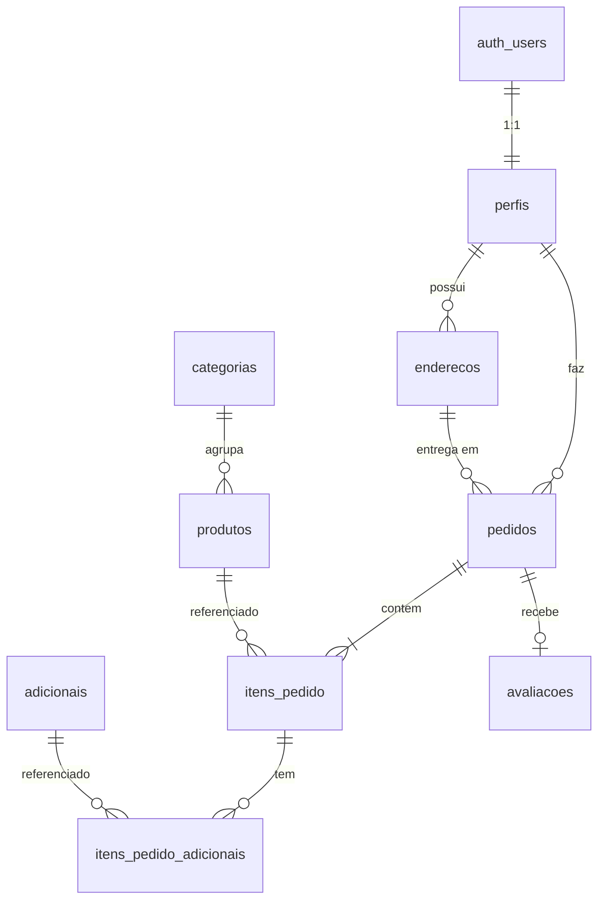

# Arquitetura de dados — BurguerTec (Supabase)

Contrato compartilhado entre o banco (`supabase/migrations/`) e o front (`src/`).
Nomes em português, `snake_case`. Valores monetários em `numeric(10,2)`.

## Diagrama (ER)



## Tabelas

| Tabela | Colunas principais | Observações |
|---|---|---|
| `categorias` | `id smallint identity PK`, `nome text unique`, `ordem int` | Ex.: Hambúrgueres, Combos, Bebidas |
| `produtos` | `id text PK` (slug, ex. `smash-classico`), `categoria_id`, `nome`, `descricao`, `preco`, `imagem_url`, `imagem_posicao text default 'bottom'`, `permite_ponto bool default true`, `ativo bool default true`, `ordem int`, `created_at` | Substitui o array `MENU` de `App.jsx` |
| `adicionais` | `id text PK` (ex. `batata`), `nome`, `preco`, `ativo` | Batata rústica = R$ 6,00 |
| `perfis` | `id uuid PK FK auth.users`, `nome`, `telefone`, `cpf unique`, `is_admin bool default false`, `created_at` | Criado por trigger no `auth.users` usando `raw_user_meta_data` (`nome`, `telefone`, `cpf`) |
| `enderecos` | `id uuid PK`, `usuario_id FK perfis`, `apelido`, `cep`, `logradouro`, `numero`, `complemento`, `bairro`, `cidade`, `uf char(2)`, `principal bool`, `created_at` | |
| `pedidos` | `id bigint identity PK`, `usuario_id FK perfis`, `endereco_id FK enderecos null` (`on delete set null`), `endereco_entrega jsonb null`, `status status_pedido`, `forma_pagamento forma_pagamento`, `subtotal`, `taxa_entrega`, `total`, `observacao`, `created_at`, `updated_at` | Total calculado no banco. `endereco_entrega` é o snapshot do endereço (`apelido`, `cep`, `logradouro`, `numero`, `complemento`, `bairro`, `cidade`, `uf`) gravado pela RPC; **`endereco_entrega IS NULL` = retirada no balcão**. O front exibe o endereço a partir dele, não de `endereco_id` |
| `itens_pedido` | `id bigint identity PK`, `pedido_id FK`, `produto_id FK`, `nome_produto` (snapshot), `preco_unitario` (snapshot, já com adicionais), `quantidade int > 0`, `ponto_carne ponto_carne null`, `observacao`, `subtotal` | |
| `itens_pedido_adicionais` | `item_id FK`, `adicional_id FK`, `preco` (snapshot); PK (`item_id`,`adicional_id`) | |
| `avaliacoes` | `pedido_id PK FK pedidos`, `usuario_id`, `nota smallint 1..5`, `comentario`, `created_at` | Só pedidos `entregue`. Colunas legíveis via API limitadas (ver Segurança) |

### Enums
- `status_pedido`: `recebido`, `em_preparo`, `saiu_para_entrega`, `entregue`, `cancelado`
- `forma_pagamento`: `pix`, `cartao_credito`, `cartao_debito`, `dinheiro`
- `ponto_carne`: `mal`, `ponto`, `bem` (mesmas chaves do `PONTO_LABEL` do front)

## Função de checkout (RPC)

```sql
criar_pedido(p_itens jsonb, p_endereco_id uuid, p_forma_pagamento forma_pagamento, p_observacao text default null)
  returns bigint  -- id do pedido
```

`p_itens` é um array de objetos:
```json
[{ "produto_id": "smash-classico", "quantidade": 2, "ponto_carne": "ponto",
   "adicionais": ["batata"], "observacao": "sem cebola" }]
```

Regras: `security definer`; exige `auth.uid()`; ignora preço vindo do front e lê de `produtos`/`adicionais` (só ativos); grava tudo numa transação.
- `p_endereco_id` NULL = retirada no balcão, taxa de entrega R$ 0,00 e `endereco_entrega` NULL.
- `p_endereco_id` preenchido = precisa ser do usuário logado, taxa de entrega R$ 5,00, e o endereço é copiado para `pedidos.endereco_entrega` (jsonb com `apelido`, `cep`, `logradouro`, `numero`, `complemento`, `bairro`, `cidade`, `uf`). Editar ou excluir o endereço depois não altera o pedido.
- Limites: até 50 itens, quantidade inteira de 1 a 99, observações cortadas em 500 caracteres.
- Erros com `errcode` 42501 (não autenticado) e 22023 (parâmetro inválido), mensagens em português.

CPF e telefone são gravados só com dígitos; CPF vazio vira NULL. CPF duplicado faz o `signUp` falhar com "Database error saving new user" (o front traduz para "Este CPF já está cadastrado.").

## Segurança (RLS)
- `categorias`, `produtos`, `adicionais`: leitura pública (`anon`, `authenticated`) só de `ativo = true`; escrita só admin.
- `perfis`, `enderecos`: o dono lê e altera os próprios dados; admin lê tudo. O usuário não pode mudar o próprio `is_admin`.
- `pedidos`, `itens_pedido`, `itens_pedido_adicionais`: o dono lê; a inserção é só pela RPC; admin lê e altera o `status`.
- `pedidos`: o snapshot `endereco_entrega` segue as mesmas regras de leitura do pedido (dono e admin).
- `avaliacoes`: o dono insere a avaliação dos próprios pedidos entregues; leitura pública para exibir as notas, **restrita por coluna**:
  - `anon` lê só `nota`, `comentario`, `created_at`;
  - `authenticated` lê `pedido_id`, `nota`, `comentario`, `created_at` (o `pedido_id` permite ao dono saber quais pedidos já avaliou);
  - `usuario_id` não é legível por ninguém via API.
  - O front deve listar as colunas explicitamente: `select('*')` ou `insert(...).select()` sem colunas retornam *permission denied*.
- Função auxiliar `is_admin()` (`security definer`, `stable`).

## Carrinho
Fica no front, persistido em `localStorage` (`burguertec:carrinho`). Só vira registro no banco ao finalizar, pela RPC `criar_pedido`.

---

## v3 — Administração: pedidos, estoque e cardápio

Migração nova: `supabase/migrations/20261109030000_admin_estoque.sql` (idempotente, roda depois da v2). Não altera migrações anteriores.

### Estoque em `produtos`
- `controla_estoque bool not null default false`
- `estoque int not null default 0`, check `>= 0`
- `estoque_minimo int not null default 0`, check `>= 0` (abaixo disso o admin vê alerta)

Regra: só produtos com `controla_estoque = true` são verificados/baixados. O seed liga o controle nos acompanhamentos e bebidas (estoque inicial 50, mínimo 10); lanches ficam sem controle.

### Tabela `movimentacoes_estoque`
| Coluna | Tipo |
|---|---|
| `id` | `bigint identity PK` |
| `produto_id` | `text FK produtos on delete cascade` |
| `quantidade` | `int not null`, `<> 0` (positivo entra, negativo sai) |
| `motivo` | `motivo_estoque` enum: `entrada`, `ajuste`, `perda`, `venda`, `cancelamento` |
| `pedido_id` | `bigint null FK pedidos on delete set null` |
| `observacao` | `text null` |
| `usuario_id` | `uuid null FK perfis` (quem fez; null quando automático) |
| `created_at` | `timestamptz default now()` |

RLS: só admin lê; ninguém insere direto (só funções).

### Mudanças em `criar_pedido` (mesma assinatura)
- Para cada produto com `controla_estoque`, soma as quantidades do pedido e trava a linha (`select ... for update`); se faltar: erro 22023 "Estoque insuficiente para <nome> (disponível: N)."
- Baixa o estoque e grava `movimentacoes_estoque` com `motivo = 'venda'` e `pedido_id`.
- Produto controlado com `estoque = 0` continua visível no cardápio; o front mostra "Esgotado" e bloqueia adicionar.

### Status do pedido
- Tabela `pedidos_status_historico` (`id bigint identity PK`, `pedido_id FK on delete cascade`, `status status_pedido`, `alterado_por uuid null`, `created_at`). Trigger grava a linha inicial no insert e uma linha a cada mudança de `status`. RLS: dono do pedido e admin leem; ninguém insere direto.
- Trigger em `pedidos` impede mudar status de pedido já `entregue` ou `cancelado` (erro 22023 "Pedido já finalizado.").
- Ao mudar para `cancelado`, devolve ao estoque os itens controlados (`motivo = 'cancelamento'`).
- O admin atualiza com `update pedidos set status = ... where id = ...` (grant de coluna já existe). O front lê o histórico para mostrar o horário de cada etapa.

### RPC `ajustar_estoque`
```sql
ajustar_estoque(p_produto_id text, p_quantidade int, p_motivo motivo_estoque, p_observacao text default null)
  returns int  -- novo estoque
```
`security definer`; exige `is_admin()`; `p_motivo` só `entrada`, `ajuste` ou `perda`; não deixa negativo (erro 22023); grava a movimentação com `usuario_id = auth.uid()`. Grant só para `authenticated` (a checagem de admin é interna).

### Cardápio pelo admin
- O admin já tem `for all` em `categorias`, `produtos`, `adicionais`, `produto_opcoes` e lê inativos. Inativar = `ativo = false` (não excluir produtos com pedidos; a FK é `restrict`).
- Grants de coluna: o admin altera `estoque` **somente** via `ajustar_estoque` (revogar update direto da coluna `estoque` para `authenticated`; demais colunas de `produtos` liberadas para update/insert, protegidas pela policy de admin).
- **Storage**: bucket público `produtos` para imagens. Leitura pública; upload/alteração/exclusão só admin (policies em `storage.objects` com `bucket_id = 'produtos' and public.is_admin()`). O front grava a URL pública em `produtos.imagem_url`. Limite 2 MB, tipos `image/jpeg`, `image/png`, `image/webp`.

### Admin lendo dados do cliente
- `pedidos` + `perfis(nome, telefone)` via embed (`usuario_id` → `perfis.id`); admin já lê ambos.
- Realtime: o admin assina `INSERT` e `UPDATE` em `pedidos` (sem filtro); o RLS libera tudo para ele.

### Notas de implementação (backend, v3)
Sem desvios de nomes, tipos ou assinaturas. Detalhes que o contrato não fixava:
- **Ordem de execução:** `…000000_schema_inicial` → `…010000_realtime_pedidos` → `…020000_cardapio_opcoes_pagamentos` → `…030000_admin_estoque` → `seed.sql`. Rodar de novo uma migração anterior que recria `criar_pedido` (a inicial ou a v2) volta a função para a versão dela; nesse caso rode a v3 outra vez.
- **`ajustar_estoque` e o sinal:** `entrada` sempre soma `|p_quantidade|`; `perda` sempre subtrai `|p_quantidade|` (o front pode mandar `perda 3`); `ajuste` usa o sinal enviado. `p_quantidade = 0` → 22023. Não admin → 42501 "Acesso restrito ao administrador.". Produto inexistente → 22023.
- **`movimentacoes_estoque.usuario_id`:** `null` em `venda` (automática; o cliente fica em `pedido_id`); em `cancelamento` grava quem cancelou; em `entrada`/`ajuste`/`perda` grava o admin. FK para `perfis` com `on delete set null`.
- **`pedidos_status_historico.alterado_por`:** `auth.uid()` de quem fez a mudança (o cliente na criação, o admin nas demais); FK para `perfis` com `on delete set null`. Pedidos anteriores à v3 recebem um histórico inicial: `recebido` no `created_at` e, se o status atual for outro, o status atual no `updated_at` (as etapas intermediárias não existem).
- **Cancelamento:** devolve exatamente o que foi baixado como `venda` naquele pedido, mesmo que `controla_estoque` tenha mudado depois. Como `cancelado` é final, não há devolução em dobro.
- **Status:** `update` com o mesmo status não grava histórico. Cliente tentando `update` em `pedidos` não recebe erro: o RLS filtra e 0 linhas são afetadas.
- **Mensagens:** usam o nome do produto. Nomes que terminam em ponto ficam com ponto duplo (ex.: "Quantidade inválida para Nuggets 10 un..").
- **Grants de `produtos`:** o `UPDATE` de tabela foi revogado e devolvido por coluna (todas menos `estoque`). **Uma coluna nova em `produtos` precisa entrar nesse grant.** `INSERT` continua liberado (o admin pode criar um produto já com `estoque`; ajustes posteriores só pela RPC).
- **Seed (carga inicial):** rodar de novo só adiciona o que falta e não sobrescreve as alterações do admin.
  - Categorias, produtos, opções e adicionais usam `on conflict do nothing`.
  - Para quem rodou o seed v1/v2, ele também: move para Lanches/Acompanhamentos/Bebidas os produtos do seed que ainda estejam numa categoria fora dessas três, e preenche `rotulo_opcao` apenas onde estiver NULL.
  - Estoque: acompanhamentos e bebidas do seed que **nunca tiveram movimentação** recebem `controla_estoque = true`, `estoque = 50`, `estoque_minimo = 10` e uma `entrada` "Estoque inicial (seed)". Depois disso o seed não mexe mais no estoque nem no controle. Lanches não são tocados.
- **Travas (concorrência):** `criar_pedido` trava logo no início, com `FOR NO KEY UPDATE` e em ordem de id, os produtos controlados citados em `p_itens`, antes de inserir os itens. `ajustar_estoque` também usa `FOR NO KEY UPDATE`. Esse modo é compatível com o `FOR KEY SHARE` que a checagem de FK de `itens_pedido` faz em `produtos`; assim, pedidos simultâneos do mesmo produto entram em fila em vez de dar deadlock (`40P01`).
- **Storage:** o bucket `produtos` é público (a URL pública não depende de policy). A policy de `select` em `storage.objects` também permite listar o bucket.

---

## v2 — Cardápio em seções, opções de sabor e formas de pagamento salvas

Migração nova: `supabase/migrations/20261109020000_cardapio_opcoes_pagamentos.sql` (idempotente, roda depois das anteriores). Não altera as migrações já existentes.

### Seções do cardápio (`categorias`)
Exatamente três, nesta ordem: **Lanches** (1), **Acompanhamentos** (2), **Bebidas** (3).
- `Hambúrgueres` é renomeada para `Lanches`; o `combo-duplo` passa para Lanches; a categoria `Combos` é removida se ficar vazia.
- O front agrupa os produtos por `categoria_id` e mostra uma seção por categoria, ordenadas por `categorias.ordem` (select: `produtos(..., categorias(nome, ordem))` ou duas consultas).

### Novas colunas em `produtos`
- `rotulo_opcao text null`: título da escolha no modal (ex.: `Sabor`, `Tipo`). Só faz sentido quando o produto tem opções.

### Nova tabela `produto_opcoes`
| Coluna | Tipo |
|---|---|
| `id` | `text PK` (slug, ex. `suco-laranja`) |
| `produto_id` | `text FK produtos on delete cascade` |
| `nome` | `text not null` |
| `preco_adicional` | `numeric(10,2) not null default 0`, `>= 0` |
| `ativo` | `bool default true` |
| `ordem` | `int default 0` |

Regra: **se o produto tem ao menos uma opção ativa, escolher uma é obrigatório**. Se não tem, `opcao_id` deve ser null. RLS igual a `produtos` (leitura pública das ativas, escrita admin).

### Novas colunas em `itens_pedido`
- `opcao_id text null FK produto_opcoes on delete set null`
- `opcao_nome text null` (snapshot)
- `preco_unitario` passa a ser produto + `preco_adicional` da opção + adicionais.

### `p_itens` (RPC `criar_pedido`, mesma assinatura)
Cada item ganha a chave opcional `opcao_id`:
```json
[{ "produto_id": "suco-natural", "quantidade": 1, "opcao_id": "suco-maracuja",
   "ponto_carne": null, "adicionais": [], "observacao": null }]
```
Erros novos (22023): "Escolha uma opção para <produto>." / "Opção inválida para <produto>."

### Novos produtos (seed)
**Acompanhamentos:** `batata-porcao` Porção de batatas (19,00) · `onion-rings` Onion rings (22,00) · `nuggets` Nuggets 10 un. (21,00) · `fritas-cheddar-bacon` (já existe).
**Bebidas:**
- `suco-natural` Suco natural 400 ml (12,00), rótulo `Sabor`: `suco-laranja` Laranja, `suco-limao` Limão, `suco-maracuja` Maracujá, `suco-abacaxi-hortela` Abacaxi com hortelã, `suco-morango` Morango (+2,00).
- `soda-italiana` Soda italiana (14,00), rótulo `Sabor`: `soda-maca-verde` Maçã verde, `soda-cereja` Cereja, `soda-limao-siciliano` Limão siciliano, `soda-frutas-vermelhas` Frutas vermelhas.
- `refrigerante-lata` (já existe), rótulo `Sabor`: `refri-cola` Cola, `refri-cola-zero` Cola zero, `refri-guarana` Guaraná, `refri-laranja` Laranja, `refri-limao` Limão.
- `agua-mineral` Água mineral 500 ml (5,00), rótulo `Tipo`: `agua-sem-gas` Sem gás, `agua-com-gas` Com gás (+1,00).
- `milkshake-baunilha` (já existe), `milkshake-morango` Milkshake de morango (19,00), `milkshake-nuts` Milkshake Nuts — creme de avelã e castanhas (21,00).

Todos os acompanhamentos e bebidas com `permite_ponto = false`.

### Nova tabela `formas_pagamento_salvas`
Atalho de preferência do cliente. **Nunca guarda número completo do cartão nem CVV.**
| Coluna | Tipo |
|---|---|
| `id` | `uuid PK default gen_random_uuid()` |
| `usuario_id` | `uuid FK perfis on delete cascade`, `default auth.uid()` |
| `tipo` | `forma_pagamento` |
| `apelido` | `text null` (ex. "Nubank") |
| `bandeira` | `text null` (visa, mastercard, elo, amex, hipercard; só cartões) |
| `final_cartao` | `char(4) null`, só dígitos (só cartões) |
| `titular` | `text null` |
| `validade` | `text null`, formato `MM/AA` (só cartões) |
| `principal` | `bool default false` |
| `created_at` | `timestamptz default now()` |

Checks: para `pix`/`dinheiro`, `bandeira`, `final_cartao` e `validade` devem ser null; para cartões, `final_cartao` obrigatório. No máximo uma `principal = true` por usuário (índice único parcial). RLS: o dono faz CRUD; admin não precisa ler. A RPC `criar_pedido` continua recebendo só `p_forma_pagamento` (o enum); o Checkout usa a forma salva para pré-selecionar.

### Notas de implementação (backend, v2)
- Mensagens de erro da opção usam o **nome** do produto: `Escolha uma opção para Suco natural 400 ml.` / `Opção inválida para Smash Clássico.` `opcao_id` vazio (`""`) conta como ausente; `opcao_id` de opção inativa, de outro produto ou de tipo não-string dá "Opção inválida".
- `formas_pagamento_salvas`: além dos checks do contrato, o banco valida `bandeira` ∈ {visa, mastercard, elo, amex, hipercard}, `final_cartao` com exatamente 4 dígitos e `validade` `MM/AA` (mês 01–12). Valores em minúsculas para `bandeira`.
- Trocar a forma principal: primeiro `update ... set principal = false where principal`, depois marcar a nova. Marcar a segunda sem desmarcar a primeira viola o índice único (`23505`).
- Ordem de execução no SQL Editor: `20261109000000_schema_inicial.sql` → `20261109010000_realtime_pedidos.sql` → `20261109020000_cardapio_opcoes_pagamentos.sql` → `seed.sql`. **Se a migração inicial for executada de novo depois da v2, ela volta `criar_pedido` à versão sem opções**; nesse caso rode a v2 outra vez.

### Perfil
- Nº de pedidos: `from('pedidos').select('id', { count: 'exact', head: true }).eq('usuario_id', uid)`.
- Alterar nome/telefone/cpf: `update` em `perfis` (só essas colunas têm grant).
- Alterar e-mail e senha: `supabase.auth.updateUser({ email })` / `({ password })`.
